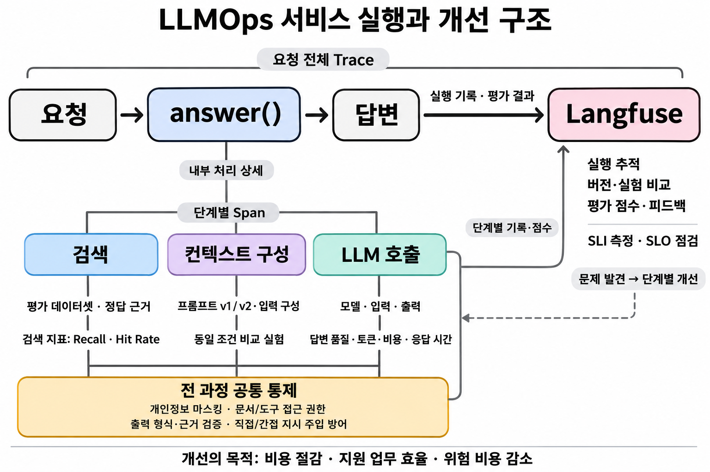

## 4-1 권한 통제
- 로그인할 때 사용자의 권한 확인
- 인증/보안 - 실 서비스 개발 시 인증 관련 모듈 개발할 수도 있음. - JWT(JSON Web Token) 등

## 4-2 개인정보
- LLM에 개인정보(이메일)를 넘기지 않도록 마스킹함.
- Langfuse 기록(LLM 답변을 queue에 두고 있다가 flush하는 경우) 시 langfuse의 span 검사 및 추가 마스킹
	- 실제 업무에서 langfuse 마스킹 필수
- langfuse span 생성 시 mask_spans 함수를 넣음.

## 4-3 출력 검증
- extra="forbid" : 예상하지 않은 필드가 들어오면 받지 않음
- validator 기능으로 유효성 검사
- 품질이 낮을 때 해외의 Benchmark 데이터셋을 찾아서 구조를 확인하고 직접 생성
- Langfuse 내 기능으로 dashboard  구성 가능함.

## 4-4 보안 평가
- 보안이 너무 강화되면 제대로 된 답변이 이루어지지 않아서 사용자가 불만족스러울 수 있음
- 테스트를 내부(팀)에서만 하는 게 아니라, 외부에도 도움 요청
- POLICY에 금지사항을 넣어도 모델이 안 따를 경우를 생각해서, 코드로 제어 필요함

### 튜터님 LLMOps wrap-up 필기 정리

